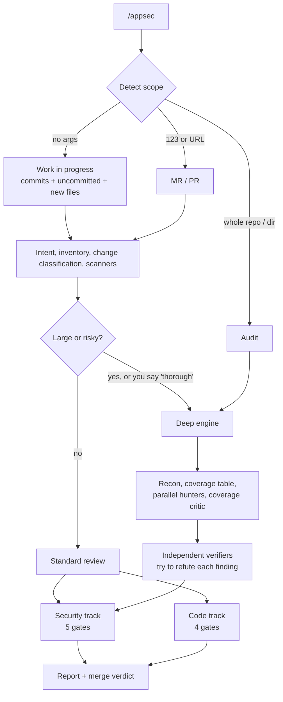

<div align="center">

# appsec

**A code review skill for Claude Code: security and code quality in one pass, reporting only what it can prove.**

[](LICENSE)
[](CHANGELOG.md)
[](https://docs.claude.com/en/docs/claude-code/skills)

</div>

---

Most automated reviews either bury you in plausible-sounding noise or miss the bug that lives in the *gap between two components*. `appsec` addresses both: every finding must pass explicit verification gates, facts the repository cannot prove are labelled **Needs validation** instead of guessed, and hunting is driven by *invariants and trust boundaries* instead of keyword lists.

Run `/appsec`. It detects the scope (your branch, an MR/PR, or the whole repo), decides how deep to go, picks the relevant domain playbooks, and returns a structured report with a merge verdict. It does not ask questions unless it cannot continue. It is read-only: no checkout, no stash, no files in your project, no probing of deployed systems.

## What it reviews

### Security track

- **Core classes**: injection, access control, authentication and session, SSRF, XSS, deserialization, cryptography, DoS, races, secrets, supply chain, CI/CD.
- **Ten domain playbooks**, selected automatically from the trust boundaries your diff touches:

| Domain | Hunts for |
|---|---|
| [`web-auth`](appsec/references/domains/web-auth.md) | HTTP desync and request smuggling, cache poisoning and deception, trusted-Host bugs, CSRF, session fixation, JWT/OAuth/SAML binding, MFA, passkey and account-recovery state transitions, API-key scope, mTLS fail-open |
| [`client-side`](appsec/references/domains/client-side.md) | DOM XSS, DOM clobbering, prototype pollution with a real gadget, `postMessage`, cross-site WebSocket hijacking, CORS, service-worker scope, XS-Leaks, clickjacking |
| [`data-isolation`](appsec/references/domains/data-isolation.md) | Tenant and object isolation, stale ACLs in search, cache and embeddings, export/backup/restore/migration leaks, deletion and revocation lifecycle |
| [`resource-exhaustion`](appsec/references/domains/resource-exhaustion.md) | Input-to-cost paths, ReDoS, decompression bombs, GraphQL depth, retry storms, poison messages, unbounded paid LLM/agent cost |
| [`protocols-messaging`](appsec/references/domains/protocols-messaging.md) | RPC, queues, webhooks, the gap between channel identity (mTLS) and the application principal |
| [`cloud-deployment`](appsec/references/domains/cloud-deployment.md) | Cloud IAM drift, Kubernetes (`hostPath`, `docker.sock`), IMDSv1, final-render checks for Helm and Kustomize |
| [`ci-release`](appsec/references/domains/ci-release.md) | `pull_request_target` "pwn requests", expression injection, unpinned actions, dependency confusion, update-metadata rollback, release integrity |
| [`local-ipc-desktop`](appsec/references/domains/local-ipc-desktop.md) | Peer authentication, deeplink and OAuth handoff, webview bridges, XPC/Binder/D-Bus/named pipes, privileged installers, TOCTOU |
| [`native-memory`](appsec/references/domains/native-memory.md) | Bounds and integer representation, lifetime and type confusion, FFI/ABI contracts, loader search order, JIT, kernel double-fetch |
| [`ai-llm-security`](appsec/references/ai-llm-security.md) | OWASP LLM Top 10 (2025), the "lethal trifecta", RAG/memory/agent/MCP hunting, confused deputy, MCP metadata used as policy |

- **Mobile** ([Android](appsec/references/mobile/android.md), [iOS](appsec/references/mobile/ios.md), [React Native and Flutter](appsec/references/mobile/cross-platform.md)): OWASP MASVS, with ready-to-run greps and a [table of common misconceptions](appsec/references/mobile/lessons.md).
- **Supply chain and DevSecOps**: lockfiles, registry sources, CVE triage by exploitability and reachability, SBOM, CI token hygiene, disabled or downgraded scanners.

### Code track

Correctness and edge cases, business logic against the spec, data migrations and API compatibility, error handling, performance, design and **over-engineering** (with a simpler alternative), tests, maintainability and conventions, operability. Severity is `BLOCKER / MAJOR / MINOR / NIT`, with nits capped at 5. Uncertain business rules become **Questions for the author**, never accusations. It reads your repo's own `REVIEW.md` / `CLAUDE.md` rules, and reports every instance of a confirmed pattern under a single finding so the author can fix the whole class in one pass.

## How it works



**Standard review** runs both tracks over the diff with a clean-context adversarial challenge for serious findings.

**Deep review** triggers automatically on diffs over 400 changed lines or 15 files, changes spanning services or two or more domains, new routes or mechanism changes in auth/payment/authorization, whole-repo scope, or when you ask for it. It works like this:

1. **Recon** maps the blast radius, including parallel code paths *outside* the diff.
2. A **coverage table** gives every unit a stable ID, a status and evidence. "I reviewed auth" does not count as coverage.
3. **Parallel hunters** run per domain, each receiving the domain's discipline rules verbatim.
4. A **coverage critic** (and a closing critic) proposes missed coverage, never findings. "Sufficiently covered" is only claimed when both are clean.
5. Every candidate goes to a **fresh independent verifier** whose job is to refute it. It may promote or demote between *Finding*, *Needs validation* and *Rejected*. HIGH and CRITICAL get a second verifier. Unverified candidates are never reported.
6. Results are saved per round, so re-reviewing the same MR after fixes is **cumulative**: fixed findings are recognised, changed source is re-checked, earlier gaps are closed. From round 3 on it reviews only the delta and says so when the approach itself may need rework.

If the session that wrote the code is also the one asked to review it, `appsec` hands the review to a clean-context subagent to avoid author bias.

## Usage

Everything after `/appsec` is plain language, not flags; all of it is optional.

| Goal | Example |
|---|---|
| Review your work in progress (commits, uncommitted and new files) | `/appsec` |
| Review a merge or pull request | `/appsec 123`, `/appsec !123`, or paste the URL |
| Review several MRs together | `/appsec 123 and 125` |
| Pick the target branch | `/appsec against develop` |
| Look only at what is not committed yet | `/appsec just my uncommitted changes` |
| Force the deep engine | `/appsec be thorough` |
| Audit a whole repo or directory | `/appsec audit the whole repo`, `/appsec src/billing` |
| Run only one track | `/appsec security only`, `/appsec code only` |
| Give the business rule to check against | `/appsec 123. Spec: invoices are visible only to their creator or an accountant of the same org` |

Before it starts, it prints one line: scope, files and lines, standard or deep, and the domains it chose.

## The report

Every review ends in a fixed structure: verdict, security and code finding counts, change classification, findings, **Needs validation**, **Questions for the author**, pre-existing issues, coverage, and SCA/DevSecOps. See the full [report template](appsec/references/report-template.md).

| Verdict | When |
|---|---|
| **Changes required before merge** | HIGH/CRITICAL security finding or BLOCKER/MAJOR code finding caused by this change |
| **Approve with comments** | Only MEDIUM/LOW/MINOR/NIT items, questions, or *Needs validation* entries |
| **Approve** | Nothing to report |

A security finding carries severity, CWE, confidence, the low-trust principal, the control that should have blocked it, the boundary crossed, the attack path, the verification performed, the smallest fix and a regression test. A *Needs validation* entry carries the trace, the missing fact, a local check and which system owner can answer it, with no severity attached.

The report is about the code only: no usernames, hostnames, timestamps or local paths.

## Design principles

Evidence or silence; few and right beats many and noisy; server-side decisions; simple by default; block only on what this change caused; read-only and traceless. The full rules are in [`appsec/SKILL.md`](appsec/SKILL.md).

## Install

Requires [Claude Code](https://docs.claude.com/en/docs/claude-code). Clone anywhere and link the `appsec` folder into your skills directory:

```bash
git clone https://github.com/defi0x1/app-security-skills.git ~/.claude/app-security-skills
mkdir -p ~/.claude/skills
ln -sfn ~/.claude/app-security-skills/appsec ~/.claude/skills/appsec
```

Or install per project:

```bash
mkdir -p .claude/skills
cp -R /path/to/app-security-skills/appsec .claude/skills/appsec
```

Update with `git pull`. Uninstall with `rm ~/.claude/skills/appsec`.

### Optional tools

`appsec` works without any of these and reports which scanners were missing.

| Tool | Used for |
|---|---|
| [`gitleaks`](https://github.com/gitleaks/gitleaks) | Secret scanning |
| [`trivy`](https://github.com/aquasecurity/trivy) | Dependency CVEs, IaC, images |
| [`semgrep`](https://github.com/semgrep/semgrep) | SAST rules |
| `gh` / `glab` | Fetching GitHub PRs / GitLab MRs (MRs can also be fetched via `git fetch` refs) |
| [Trail of Bits plugins](appsec/references/tob.md) | Second opinions (false-positive check, differential review, variant analysis) |

## Repository layout

```text
appsec/
├── SKILL.md                         single entry point and principles
├── workflows/
│   ├── review.md                    standard flow: scope, diff, scanners, security, code, challenge, report
│   └── review-deep.md               deep engine: recon, coverage, hunters, critic, verifiers, rounds
└── references/
    ├── code-review.md               code track: severity, gates, intent sources, over-engineering table
    ├── secure-coding-patterns.md    wrong / bypass / right tables, known-safe patterns
    ├── hunting-method.md            invariants, boundary test, domain selection, feature abuse, chaining
    ├── domains/                     nine of the ten domain playbooks (the tenth is ai-llm-security.md)
    ├── severity-cwe.md              severity anchors and finding types mapped to CWE
    ├── change-classification.md     10 change groups, sensitive-area recipes
    ├── supply-chain-devsecops.md    lockfiles, registries, CVE triage, CI tokens
    ├── secure-design.md             design notes, STRIDE per element, acceptance criteria
    ├── ai-llm-security.md           OWASP LLM Top 10 2025 and agent/MCP hunting
    ├── mobile/                      Android, iOS, cross-platform, lessons
    ├── report-template.md           report format
    ├── multi-mr.md                  multiple MRs and repos
    └── tob.md                       optional Trail of Bits integration
```

## FAQ

**Does it change my code or post comments?** No. It is read-only. At the end it suggests a next step (apply a fix, post MR comments) and does it only if you agree.

**Does it need a GitHub or GitLab remote?** No. It works on a plain local repo. Remotes only matter for fetching MRs/PRs by number.

**Will it flag everything?** Deliberately not. A rule that cannot say when something is *not* a finding does not belong here.

**Which language does it answer in?** Yours. Code and identifiers stay in English.

## Contributing

Issues and pull requests are welcome, especially false negatives, false positives, and new domain playbooks. See [CONTRIBUTING.md](CONTRIBUTING.md).

## Acknowledgements

The invariant-based hunting method, domain playbooks, deep-review engine and the agent/MCP hunting section were adapted from [cloudflare/security-audit-skill](https://github.com/cloudflare/security-audit-skill) (MIT), rewritten and condensed for Claude Code. See [THIRD_PARTY_NOTICES.md](THIRD_PARTY_NOTICES.md).

## Disclaimer

`appsec` is an aid for reviewers, not a replacement for a security audit or penetration test. Findings are produced by a language model and must be reviewed by a person.

## License

[MIT](LICENSE)
